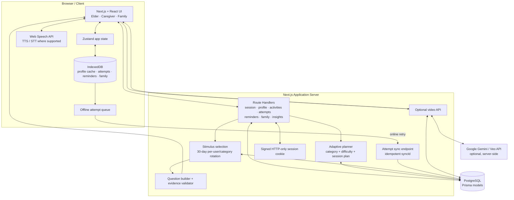

# SAMSMARANA — System Architecture

The diagram reflects the current repository implementation. It separates browser-side experience, Next.js API routes, application services and persistence.

## Main flows

### Activity recommendation
1. The client requests activities or a session plan.
2. The API loads recent attempts for the active profile.
3. The adaptive engine recommends activity categories and difficulty using recent performance and skip patterns.
4. The client presents the recommendation.

### Stimulus and question delivery
1. The client requests a stimulus for an activity category.
2. The server selects a scene using the profile's stimulus history and 30-day cooldown.
3. A question set is built from structured scene evidence.
4. Each question is validated against that evidence before the response is returned.

### Offline activity sync
1. The client records an attempt in IndexedDB first.
2. If online, it immediately posts the attempt; otherwise it remains queued.
3. When connectivity returns, the sync coordinator drains pending attempts.
4. The backend uses the unique `syncId` to make retries idempotent.

### Caregiver insights
The insights API aggregates saved attempts into completion counts, average accuracy, response time, category summaries, streaks and recent activity. Observations are engagement-only and non-diagnostic.

### Optional video generation
The video API creates a server-side generation request using Gemini/Veo when a key is configured. The status route polls the provider and returns a ready, failed or unavailable state. The standard activity path remains available as a fallback.

## Implementation boundary

The current code uses Prisma for database access and a signed cookie for the demo session. Supabase configuration appears in the sample environment documentation, but a Supabase client/auth implementation is not part of the current package dependencies. The Prisma schema declares PostgreSQL; use a PostgreSQL connection string for the current schema.
